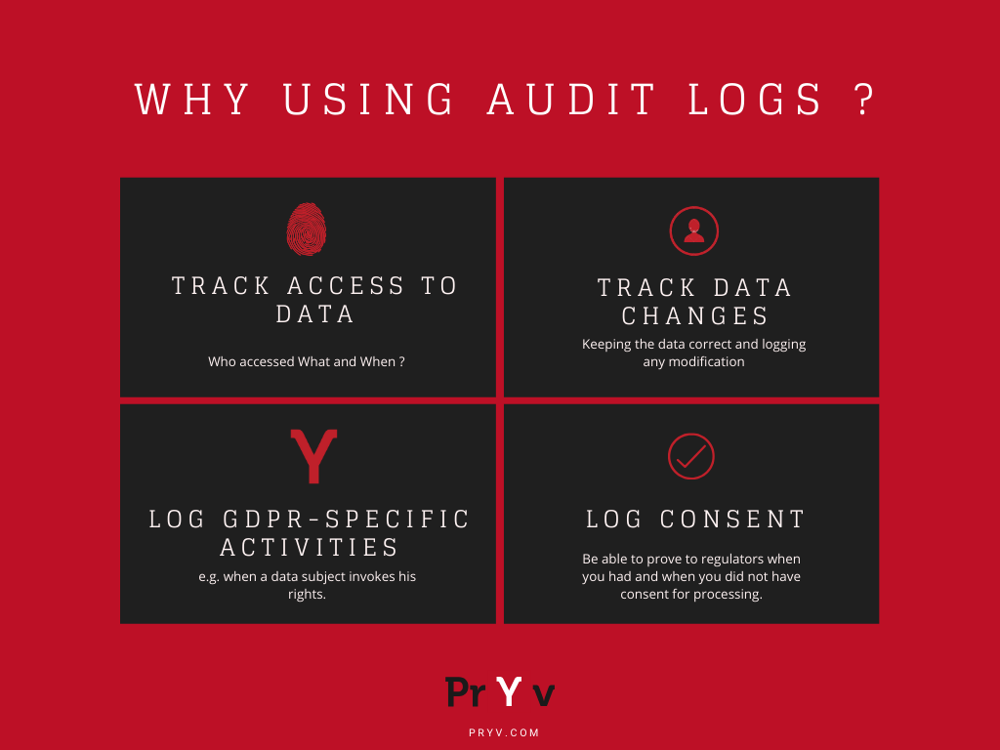

In this guide we address developers that wish to use audit logs on Pryv.io to capture changes to a system and keep records of the interactions that were made with the data.  
It describes what Audit Logs are, why to use them and how they were designed on Pryv.io. It goes through a possible use case to explain how auditing works with Pryv.io.

## Table of content

1. [Introduction](#introduction)
2. [Audit Logs](#audit-logs)
  1. [What are Audit Logs?](#what-are-audit-logs)
  2. [Accesses the server writes](#accesses-the-server-writes)
  3. [The creation of the account](#the-creation-of-the-account)
  4. [Who is allowed to audit what?](#who-is-allowed-to-audit-what) 
  5. [How to filter audit queries?](#how-to-filter-audit-queries)
  6. [How to retrieve Audit Logs in Pryv.io](#how-to-retrieve-audit-logs-in-pryvio)
3. [Why using Audit Logs on Pryv.io](#why-using-audit-logs-on-pryvio)

## Introduction

In regards to new requirements on data privacy, you need to be able by now to track all activities related to the personal data you hold on your servers. This includes tracking of consents, data accesses, data retrievals, but also tracking of data changes.

Audit logs are considered to be the best way of demonstrating compliance – and “demonstrating compliance” is a key point of new privacy regulations. Keeping logs of processes made on personal data is not only a best practice, but a must for you to achieve compliance.
To see which regulation requirements audit logs help you meet (GDPR, HIPAA, Swiss nLPD and others), see the [Pryv compliance matrix](https://pryv.github.io/compliance-matrix/).

Audit capabilities on Pryv.io now enable you to keep track of data in your system and to generate audit logs.

## Audit logs

### What are audit logs?

Let’s take a quick overview of what exactly are `Audit logs`.

An audit log shows “who” did “what” activity and “how” the system behaved. It comes in the form of a document that records chronologically all the interactions that were made with the personal data stored on the servers : what resources were accessed, the destination and source addresses, a timestamp and the user login information.

When using Pryv.io, it enables you to keep track of details about the actions performed by clients against Pryv.io accounts through the Pryv.io API. 

You can take a look on what an `Audit log` looks like on Pryv.io :

```json
{
  "id": ":_audit:ckqujnth400081eow07wcbfr7",
  "streamIds": [
    ":_audit:access-ck6j78uj600011ss2neygkpub",
    ":_audit:action-events.get"
  ],
  "time": 1625726631.928,
  "type": "audit-log/pryv-api",
  "content": {
    "source": {
      "name": "http",
      "ip": "85.5.225.68"
    },
    "action": "events.get",
    "query": {
      "toTime": "9900000000",
      "fromTime": "0",
      "limit": "100",
      "sortAscending": "false",
      "state": "all"
    }
  },
  "created": 1625726631.928,
  "createdBy": "system",
  "modified": 1625726631.928,
  "modifiedBy": "system",
}
```

As you may have recognized, it is an event of type `audit-log/pryv-api`. You can find its defails [here](/event-types/#audit-log).

Audit logs are available through the [Events API](/reference/#get-events). However they are read only, thus cannot be modified.

### Accesses the server writes

From the release after 2.0.0-rc.89, every creation, change of permissions or expiry, and deletion of an **app** or **shared** access leaves a record that names the access in the trail of its account:

- the `accesses.create`, `accesses.update` or `accesses.delete` record when an API client did it. The last two carry `content.record.accessId`, and `related`, the accesses deleted with it;
- an `oauth.*` event with `accessId` when it is the issuance of an OAuth session;
- otherwise an `accesses.created`, `accesses.changed` or `accesses.deleted` record written by the server, of type `audit-log/access`:

```json
{
  "streamIds": [":_audit:access-cmr7f2k1x0001pdrt5a8d3h9q", ":_audit:action-accesses.deleted"],
  "type": "audit-log/access",
  "content": {
    "action": "accesses.deleted",
    "source": { "name": "oauth2" },
    "record": {
      "accessId": "cmr7f2k1x0001pdrt5a8d3h9q",
      "accessType": "app",
      "kind": "oauth-grant",
      "cause": "refresh-token-reuse",
      "related": ["cmr7f2k1x0002pdrt7c1e6m4v"]
    }
  }
}
```

| Field | Meaning |
|---|---|
| `source.name` | the part of the server: `oauth2`, `cmc`, `delegation`, `account`, `operator-cli`. No `ip`: no client connection made the write |
| `record.accessId`, `accessType`, `kind` | the access, and what it is for when the server knows |
| `record.cause` | why, for example `consent-subject-changed`, `grant-changed`, `client-revocation`, `refresh-token-reuse`, `address-alias-deleted`, `client-purged`, `plugin` |
| `record.by` | the access of this account that asked for it, when one is known |
| `record.related` | the accesses deleted with it; each is also on its own `access-` stream of the record |
| `record.changed` | `permissions`, `expires` |
| `record.grantId` | the grant whose change caused it |

The `access-` stream of these records names the access that was written, not one that made a call. For a write of the cross-account messaging or delegation plugin, the access that asked is the one on the record of the triggering call, at the same second. Not recorded this way: personal accesses (the sign-in is their record), an access that ends by its own expiry, a session removed because its authorization code was never exchanged, and one-off upgrade tools.

### The creation of the account

From the release after open-pryv.io 2.0.0-rc.89, an account created on a core has a record of its creation as the first record of its own trail. The call that creates an account (a registration, `system.createUser`) is audited without a user, so before this release the trail of a new account started with its first later call. The server writes an `account.created` record of type `audit-log/account` once the account exists, for a registration (`POST /users`, `/reg/users`, the legacy `/reg/user`), `system.createUser` and `delegations.createAccount`:

```json
{
  "streamIds": [":_audit:access-cmr7f2k1x0001pdrt5a8d3h9q", ":_audit:action-account.created"],
  "type": "audit-log/account",
  "content": {
    "action": "account.created",
    "source": { "name": "registration", "ip": "85.5.225.68" },
    "record": { "accessId": "cmr7f2k1x0001pdrt5a8d3h9q", "accessType": "personal" }
  }
}
```

| Field | Meaning |
|---|---|
| `source.name` | how the account was created: `registration`, `system` or `delegation` |
| `source.ip` | the client address, for a registration only (the account holder's own, as on the later call records of the trail); left out when unknown. An administrator's or a delegate's address is never recorded |
| `record.accessId`, `accessType` | the personal access made with the account; the record is also on that access's `access-` stream, so the history of the first personal access starts with its creation. Empty when no personal access was made (`delegations.createAccount`, `system.createUser` without `appId`) |

The record holds ids and fixed words only: no username, address, password, token, app id, invitation or custom field. A registration forwarded to another core is recorded on the core that creates the account, with the client address the receiving core saw. A refused registration leaves no record. A record that cannot be written does not fail the creation; it is counted as a [lost audit record](/customer-resources/audit-setup/#records-that-could-not-be-written). Accounts created earlier have no such record. The type `audit-log/account` is listed in the event-type catalogue from data-types 1.4.0.

### Who is allowed to audit what?

The logs you are allowed to query depend on the access you are using.

#### Personal token

Whe using a **personal** token, you can query actions performed by any other access. You can also create **app** and **shared** accesses to audit any other access, by adding [permissions](/reference/#access) to the audited access id, such as:

```json
{
  "streamId": ":_audit:access-MY_AUDITED_ACCESS_ID",
  "level": "read"
}
```

#### App and shared tokens

When using an **app** or **shared** token, you can only query actions performed by the access you are using, and the permissions you were explicitely given on others.

### How to filter audit queries?

You can filter the sort of logs you wish to [query](/reference/#get-events) by **action** and **access id**. Each audit log gets 2 streamIds in the form of:

1. `:_audit:action-{method-id}`, see [API method ids](/reference/#method-ids).
2. `:_audit:access-{access-id}`, the id of the access that performed the action.

### How to retrieve Audit Logs in Pryv.io?

#### Build streamId

You can obtain the streamId related to the access you wish to audit by prefixing `:_audit:access-` to the access id such as:  

`:_audit:access-ckv85dn1a00011io99u37iflu`.

#### Streams parameter

In order to obtain audit events, you must specify the audit stream(s) in the [streams parameter of the events.get API method](/reference/#get-events). You can fetch any audit log by providing `:_audit:` or a specific one by providing an access or method id.

## Why using Audit Logs on Pryv.io

In addition to providing proof of compliance and operational integrity, audit logs can help you monitor activity on your servers :

- by tracking access to data : **who** accessed **what** and **when**. You can track all accesses to data and check that only the authorized users have read the data.
It can be used to see whether a user account has been hacked, or whether user account privileges were escalated to access specific files or directories with sensitive information.

- by tracking data changes. One of the principles of GDPR being “integrity”, you have to be able to reconstruct the lifecycle of any data flowing in your system. This means keeping the data correct and logging any modification.

- by logging GDPR-specific activities, e.g. when a data subject invokes his rights. Each request can be securely logged so that you can prove to authorities the exact sequence of events relating to the particular data subject.

- by logging consent and the accompanying context (date, time, IP address, etc). The consent withdrawal must also be logged, so that the whole history of the consent of the data subject is transparent. This way you will be able to prove to regulators wh

